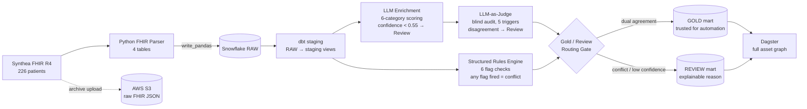
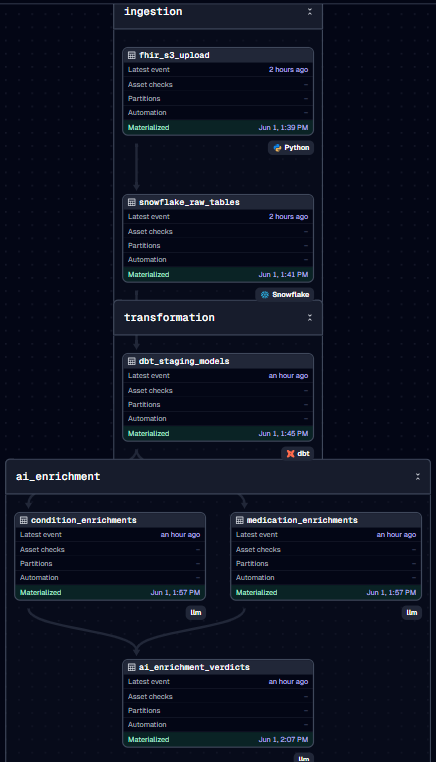

# Trust but Verify: Clinical AI Governance Engine

[](https://github.com/ericg1212/ai-healthcare-pipeline/actions/workflows/ci.yml)
[](https://github.com/ericg1212/ai-healthcare-pipeline/actions/workflows/codeql.yml)
[](https://github.com/ericg1212/ai-healthcare-pipeline/releases)
[](https://hl7.org/fhir/R4/)
[](https://aws.amazon.com/s3/)
[](https://www.snowflake.com/)
[](https://www.getdbt.com/)

[](https://dagster.io/)
[](https://www.python.org/)


**By [Eric Grynspan](https://www.linkedin.com/in/ericgrynspan/)** &nbsp;·&nbsp; [← Denied](https://github.com/ericg1212/healthcare-claims-pipeline) &nbsp;·&nbsp; [Cleared →](https://github.com/ericg1212/agentic-rcm-pipeline)

---

Denied classifies denials retrospectively. Trust but Verify adds AI governance. Cleared prevents the denial before it happens.

| Pipeline | Focus | Status |
|---|---|---|
| [Denied](https://github.com/ericg1212/healthcare-claims-pipeline) | Retrospective denial classification — separate ~27.6K systematic denials with an upstream fix from 229K documentation failures requiring a different intervention | Complete |
| **[Trust but Verify *(this project)*](https://github.com/ericg1212/ai-healthcare-pipeline)** | Clinical AI governance — LLM enrichment + rules engine cross-validation, every routing decision explainable | Complete |
| [Cleared](https://github.com/ericg1212/agentic-rcm-pipeline) | Pre-submission denial prevention — deterministic NCCI gate with LLM tool-use on edge cases, every action cites its rule | Complete |

---

Clinical documentation gaps are the leading driver of prior authorization denials and downstream revenue loss — a problem that CMS-0057-F now mandates health systems address with real-time decision transparency. Yet most AI enrichment pipelines produce a risk score with no audit trail. This pipeline builds the governance layer that's missing: every LLM output is cross-validated by a deterministic rules engine, confidence scores flag uncertainty before it reaches production, and any conflict routes to a human review queue with an explainable reason. The result is a two-tier output — a **Gold layer** you can trust for automated action and a **Review layer** with a traceable reason for every flagged record.

**Trust but verify:** The LLM and the rules engine must agree for a record to pass to Gold. Conflict or low confidence → Review, automatically, with a reason.

---

## Results

| Metric | Value |
|---|---|
| Records enriched | 174 (166 judged; 8 judge API errors; 26 enrichment errors) |
| Avg overall_confidence | 0.584 across conditions + medications |
| Judge disagreement, raw (v1 prompt) | **166 of 166 (100%, 95% CI 97.7-100%)** |
| **Gold clean, as reported** | **13 of 166 (7.8%, 95% CI 4.6-12.9%)**, after the post-hoc exemption below |
| Review: low confidence | 39 (23.5%): judge agreed after exemption, confidence < 0.55 |
| Review: conflict | 114 (68.7%): judge disagreement, not exempted |
| Confidence threshold | 0.55 (batch average 0.584). 93% of conflict records already clear it, so it does not drive the Gold rate |
| Post-hoc exemption | 52 conditions tagged finding / situation / person in SNOMED (37 / 14 / 1) were moved out of conflict by a retroactive step outside this repo. They include clinical findings (cough, prediabetes, BMI 30+) as well as social ones (employment, housing). The rule is now explicit in `ai_layer/judge_triggers.py` and reproducible with `python -m quality.trigger_audit` |
| Root cause of the 100% | v1 trigger 1 qualifies on "no onset date" (true for 174/174: onset is not an enrichment input) or a "3-character ICD-10 code" (true for 0/174), so it fires on any score >= 0.85 (152 of 166, 91.6%) |
| Judge categories cited (v1) | coding_accuracy 141, diagnosis_specificity 81, drug_condition_alignment 16, medication_appropriateness 12, clinical_urgency 3 |
| Rubric v2, offline | Qualifiers applied as written fire on 0 of 166 records, so the projected Gold rate is the confidence gate alone (119 of 166 = 71.7%, CI 64.4-78.0%). It is not a quality estimate and is unvalidated; v2 is not wired into the router |
| Prompt cache hit rate | ~90%+ on batches > 10 records |
| Pydantic validation failures | Raised at parse time, zero silent failures downstream |

> **How to read the 7.8%:** one run (2026-06-04) on 174 synthetic Synthea records. It is a post-hoc figure, not a performance benchmark and not evidence about real EHR data. The v1 judge disagreed with every record, so that gate was not discriminating. What holds: every non-Gold record carries an explainable reason, and the routing is reproducible from the saved export. **Validation status:** a judge re-run with a corrected prompt and a 50-record hand-labeled sample (judge precision and recall) are pending; until then the Gold rate is uncalibrated.

---

## Architecture





*8-asset Dagster pipeline — ingestion → staging → AI enrichment (parallel) → LLM-as-Judge → Gold/Review routing → dbt marts*

---

## Why Dual Validation?

A single confidence score only tells you how certain the model is about its own output — it cannot catch domain rule violations a generalist model might miss. Two orthogonal validators, two different failure modes:

| Validator | Failure Mode It Catches |
|---|---|
| **LLM-as-Judge** | Statistical inconsistencies within the AI output — inflated scores, flat scoring, internal contradictions |
| **Rules Engine** | Domain violations — vague or placeholder diagnoses, acute or high-risk chronic conditions missing an onset date, high-alert medications, blank RxNorm codes |

Both must agree for Gold. One disagrees → Review, with a reason.

---

## AI Layer

Four components run on every record — all four are live.

**1. LLM Enrichment** ✓ Live

Each condition and medication record is scored across 6 clinical quality dimensions. The LLM is called via `tool_use` — structured output only, no free-text parsing. The system prompt (~2,000 tokens) is prompt-cached, so calls 2–N in a batch cost ~10% of the first call's input token price.

| Category | What It Measures |
|---|---|
| `diagnosis_specificity` | SNOMED CT / RxNorm concept specificity — leaf-level concepts score high, broad category codes score low |
| `clinical_urgency` | Implied acuity — acute/life-threatening vs. stable chronic vs. preventive |
| `coding_accuracy` | Description-to-code alignment — catches mismatches between free text and coded values |
| `medication_appropriateness` | Whether the medication is clinically reasonable given the record context |
| `drug_condition_alignment` | Recognized drug-condition pairing — metformin + T2D, lisinopril + hypertension, etc. |
| `comorbidity_risk` | Multi-condition risk signal — T2D + CKD, metabolic syndrome clusters |

Each category returns a score (0.0–1.0) and a one-sentence rationale citing the specific code or clinical pattern. `overall_confidence` is a weighted average: `diagnosis_specificity` and `coding_accuracy` at 1.5×, all others at 1×. A Pydantic `model_validator` enforces that `overall_confidence` cannot diverge more than 0.25 from the category average — invalid enrichments raise at parse time, not silently downstream.

**2. LLM-as-Judge** ✓ Live

A second LLM call audits the enrichment result. The judge receives scores only — rationale is hidden to prevent anchoring bias. Five disagreement triggers are defined:

1. **Inflated score** — category ≥ 0.85 on a Synthea record with a broad-category SNOMED concept or generic description
2. **Deflated score** — category ≤ 0.25 on a well-known chronic condition or textbook first-line medication
3. **Internal inconsistency** — `coding_accuracy ≥ 0.8` with `diagnosis_specificity ≤ 0.4`, or `medication_appropriateness ≥ 0.85` with `drug_condition_alignment ≤ 0.3`
4. **Overall drift** — `overall_confidence` diverges more than 0.20 from the simple category average
5. **Flat scoring** — all 6 scores within 0.05 of each other (enricher was not discriminating)

When the judge disagrees, it returns `corrected_confidence`, the specific `disagreement_categories`, and a one-sentence clinical reason. Both LLM calls use prompt caching on their respective system prompts.

**3. Structured Rules Engine** ✓ Live

Deterministic Python — 6 flag checks named after the scoring dimensions (diagnosis specificity, clinical urgency, coding accuracy, medication appropriateness, drug-condition alignment, comorbidity risk). Runs parallel to the LLM on every record. Any flag fired routes the record to Review as a conflict, and the `review_reason` names the flags.

**4. Gold / Review Routing** ✓ Live

LLM-as-Judge disagreement or rules engine conflict → Review queue with explainable reason. Full agreement → Gold layer. Three Gold record states: `enriched_clean` (trusted for downstream analytics), `enriched_review_conflict` (judge disagrees or rules fired), `enriched_review_low_confidence` (both agree but confidence < 0.55). Each Review record carries a `review_reason` string — a human-readable explanation of exactly why it was flagged.

---

## Design Decisions

| Decision | Why |
|---|---|
| **`tool_use` over free-text parsing** | Structured output enforced at the API level — malformed JSON is impossible, Pydantic validates at parse time |
| **Prompt caching** | Identical ~2,000-token system prompt across every record — calls 2–N cost ~10% of call 1 |
| **`model_validator` on `overall_confidence`** | HIGH overall confidence can't mask LOW category scores — ≤0.25 divergence enforced at parse time |
| **Rationale hidden from the Judge** | Anchoring bias — a judge that sees the reasoning rationalizes instead of auditing |
| **Deterministic rules alongside the LLM** | High-alert medication and comorbidity flags need a stable, auditable floor — LLMs drift run-to-run |
| **Confidence threshold below batch average** | 0.55 sits under the observed 0.584, so records at the mean clear the confidence gate; conflicts, not confidence, drive most Review routing (114 of 153). Raise the threshold to widen human review once capacity is known |
| **Terminology validation before enrichment** | Drifted SNOMED/RxNorm codes produce confident but wrong enrichments — the validator runs in the `run_enrichment` CLI before any LLM call (the Dagster assets do not call it) |
| **Claude over GPT-4 / Gemini** | `tool_use` is a first-class primitive, caching is native, and the context window fits full patient injection |

---

## Stack

| Layer | Technology | Role |
|---|---|---|
| Synthetic data | Python FHIR R4 (Synthea) | PHI-free patient population — 226 patients, 25,958 clinical records |
| Raw archive | AWS S3 | Raw FHIR JSON uploaded before the load (archive, not the load source) |
| Warehouse | Snowflake | RAW (loaded with `write_pandas`, 4 tables) → staging → GOLD / REVIEW marts |
| Transformation | dbt | Staging views + `gold_records` / `review_records` marts |
| AI enrichment | LLM API (Anthropic) | 6-category enrichment + LLM-as-Judge blind audit, both prompt-cached |
| Orchestration | Dagster | 8 software-defined assets — ingestion → enrichment → routing → marts |
| CI | GitHub Actions | lint, pytest, CodeQL |
| Language | Python 3.13 | FHIR parser, AI layer, rules engine |

---

## Testing

```bash
make test   # pytest with coverage
```

23 tests, concentrated on the deterministic governance components: the Structured Rules Engine (12 — flag logic across the 6 checks), the terminology validator (10 — SNOMED/RxNorm code drift) and 1 placeholder. The enricher, judge and router are exercised by the demo run rather than by unit tests. CI runs lint + pytest on every push; CodeQL scans weekly.

---

## Project Structure

```
ai-healthcare-pipeline/
├── data_ingestion/      # Synthea wrapper · FHIR R4 parser · S3 archive upload + Snowflake write_pandas load
├── ai_layer/            # enricher, judge, rules engine, router · Pydantic schemas · CLI
├── dbt_pipeline/        # staging views + gold_records / review_records marts
├── dagster_pipelines/   # 8 software-defined assets: ingestion → enrichment → routing → marts
└── tests/               # pytest unit tests
```

---

## Quickstart

```bash
git clone https://github.com/ericg1212/ai-healthcare-pipeline.git
cd ai-healthcare-pipeline
cp .env.example .env          # populate with your credentials
pip install -r requirements.txt
make test
```

See `.env.example` for required environment variables.

---

## Note on Synthetic Data

All patient records are generated by the Synthea synthetic patient engine. No real PHI is used, stored, or transmitted at any point in this pipeline.

---

## Author

**Eric Grynspan** — Data Engineer · Financial Services & Healthcare

[](https://www.linkedin.com/in/ericgrynspan/)
